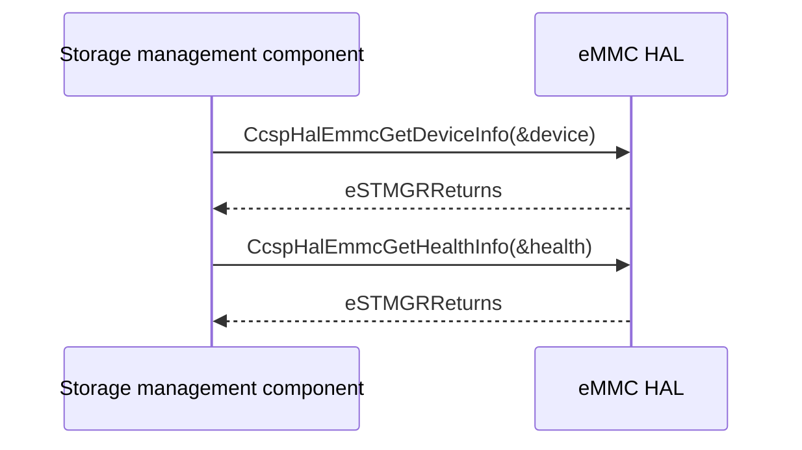

# eMMC HAL Specification

## Version History

| Date | Comment | Version |
| --- | --- | --- |
| — | Documentation alignment; no ABI change. | — |

## Acronyms
HAL means Hardware Abstraction Layer; eMMC means Embedded Multi-Media Controller; SMART means Self-Monitoring, Analysis, and Reporting Technology.

## Description
The storage management component uses this HAL to retrieve eMMC device and health information.

## Optional Components
SMART information and vendor diagnostics depend on the implementation.

## Component Runtime Execution Requirements
### Initialization and Startup
Obtain information when the platform storage service is available.
### Threading Model
Serialize calls unless the vendor supplies stronger guarantees.
### Process Model
Call the vendor library in process.
### Memory Model
Callers own writable output structures. Respect the header's array capacities and string bounds, and interpret diagnostic union data using the vendor contract.
### Internal Error Handling
Both functions return `eSTMGRReturns`: success `0`, generic failure `-1`, initialization failure `-2`, invalid input `-3`, unknown failure `-4`. Do not consume failed output.
### Persistence Model
These getters do not change persistent storage configuration.

## Nonfunctional Requirements
### Logging and Debugging
Implementations must not log credentials, secrets, security-sensitive information, or other sensitive data. Log operation outcomes rather than payloads.
### Quality Control
Test output bounds and each specified return category against the actual implementation. Use compiler warnings, static analysis, and memory checking.
### Licensing
See repository Apache-2.0 notices.
### Build Requirements
Include the public header and link the implementation selected by the product recipe.
### Variability Management
Do not infer supported device types from enum membership alone.

## Interface API Documentation
| Function | Contract |
| --- | --- |
| `eSTMGRReturns CcspHalEmmcGetHealthInfo(eSTMGRHealthInfo *pHealthInfo)` | Writes operational/health flags and vendor diagnostic and lifetime information to caller storage. |
| `eSTMGRReturns CcspHalEmmcGetDeviceInfo(eSTMGRDeviceInfo *pDeviceInfo)` | Writes identity, type, capacity, status, partitions, and firmware/hardware metadata to caller storage. |

### Theory of Operation and Key Concepts
`eSTMGRDeviceStatus` contains bit flags, not a mutually exclusive state list. Device capacity is vendor-specific; partition capacity is expressed in bytes.

### Sequence Diagram

## Source References
- [ccsp_hal_emmc.h](https://github.com/rdkcentral/rdkb-halif-emmc/blob/develop/include/ccsp_hal_emmc.h)
